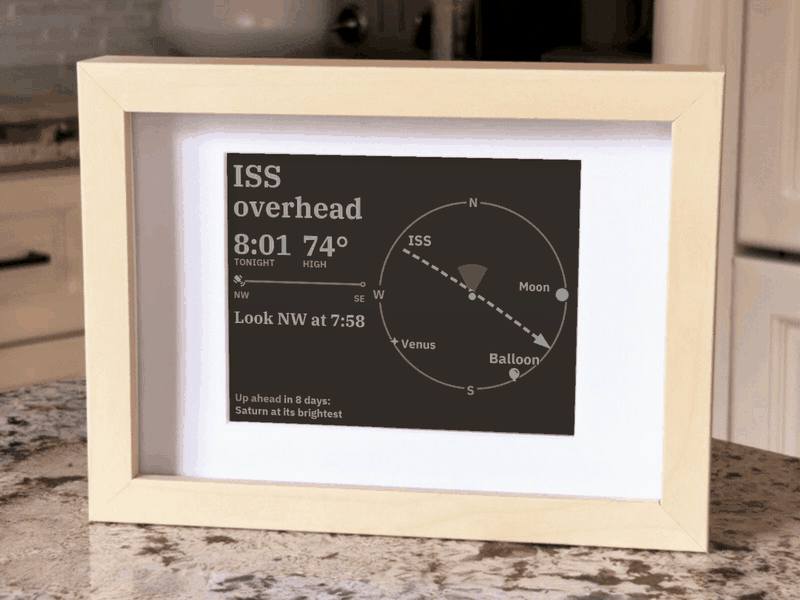
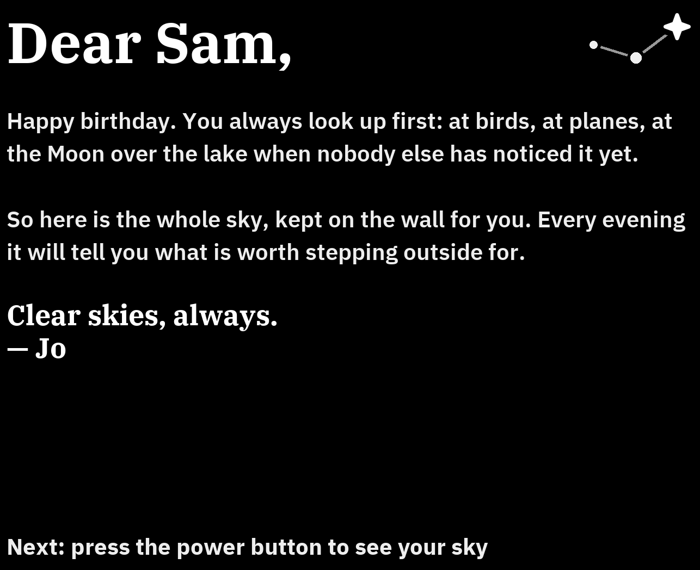

# Kindle Sky

A Kindle in a picture frame that shows what's in the sky above your home.



A jailbroken Kindle Paperwhite draws the sky as a map seen from above: straight overhead in
the middle, the horizon at the rim, the way you face at the top. On it are the ISS and
China's Tiangong station, fresh Starlink trains, weather balloons from the nearest launch
site, the Moon, the planets and the brightest stars. Beside it, one headline for the thing
most worth looking up for right now, and what's coming: tonight's ISS pass, the next meteor
shower, an eclipse of the Moon.

The Sun, Moon, planets and stars are worked out on the Kindle itself, so it turns on Wi-Fi
only for satellite orbits and weather balloons, about 65 times a day. A charge lasts about
two weeks. Everything runs on the Kindle; your computer is only needed to install it.

What it shows and how it picks the headline: [docs/sky.md](docs/sky.md).

Sky is the second frame on this hardware. The first,
[kindle-planes](https://github.com/azilnik/kindle-planes), shows the flights overhead. Living
with it taught the loop to sleep between redraws and fetch only what it can't work out
itself, which took a charge from about 5 days to about 13.

## What you need

- A Kindle Paperwhite 4 (2018) or Paperwhite 2 (2013) that you can jailbreak
- An [IKEA RÖDALM 13×18 cm frame](https://www.ikea.com/ca/en/p/roedalm-frame-birch-effect-30548866/)
  and two 3D-printed parts to hold the Kindle in it ([docs/frame.md](docs/frame.md))
- A right-angle micro-USB plug or adapter, since a straight plug doesn't fit in the frame
- A Mac or Linux computer with [uv](https://docs.astral.sh/uv/)

## Install

1. **Jailbreak the Kindle and set up SSH.** This is the slow part, and you only do it once.
   Follow [docs/device-setup.md](docs/device-setup.md) until `ssh kindle` works.
2. **Install.** Press the Kindle's power button once to wake its Wi-Fi, then run, with your
   own latitude and longitude:

   ```bash
   git clone https://github.com/azilnik/kindle-sky && cd kindle-sky
   tools/install.sh --home 43.65,-79.38
   ```

   It works out which Kindle it is, copies Python and the code over, and starts the display
   on every boot. Within a minute the Kindle shows your sky. For a second Kindle, give its
   SSH name: `KINDLE=kindle2 tools/install.sh --home ...`.
3. **Frame it.** Print the insert and back plate for your Kindle and put it in the frame.
   See [docs/frame.md](docs/frame.md).

Then set which way you face the frame (`heading`), your time zone (`tz`) and how dark your
sky is (`sky_glow`) in the Kindle's `config.json`: [docs/configuration.md](docs/configuration.md).

Already running [kindle-planes](https://github.com/azilnik/kindle-planes)? `tools/install.sh`
takes its place and keeps its settings.

## Give it as a gift

The frame can open with a letter, shown until whoever unwraps it presses the power button,
and back every year on that day. `tools/gift.sh letter.txt`; see
[docs/sky.md](docs/sky.md#give-it-as-a-gift).



## Try it without a Kindle

Render every sample situation into one image:

```bash
tools/check.sh
```

That lints, runs the screen loop on a fake clock, and renders every sample as a Paperwhite 4
(`out/sheet.png`) and a Paperwhite 2 (`out/sheet-pw2.png`) see it. No network, no Kindle.

## With an agent

The repo is set up for coding agents like [Claude Code](https://claude.com/claude-code):
[AGENTS.md](AGENTS.md) has the device facts and step-by-step playbooks an agent needs. With
your Kindle on `ssh kindle`, you can ask things like *"install this on my Kindle, I live in
Vancouver"*, *"turn the dome so I'm facing west"* or *"why did the frame stop updating?"*.

## More

- [docs/sky.md](docs/sky.md): what's on the screen, what leads, where the data comes from
- [docs/configuration.md](docs/configuration.md): every setting, and the power button
- [docs/device-setup.md](docs/device-setup.md): jailbreak, SSH, what's on the Kindle
- [docs/frame.md](docs/frame.md): the 3D prints and measuring the visible area
- [docs/power.md](docs/power.md): battery life, measured
- [build/](build/): how the Kindle's Python is built

## License

MIT. The fonts, orbit code and star data keep their own licenses; see [LICENSE](LICENSE).
