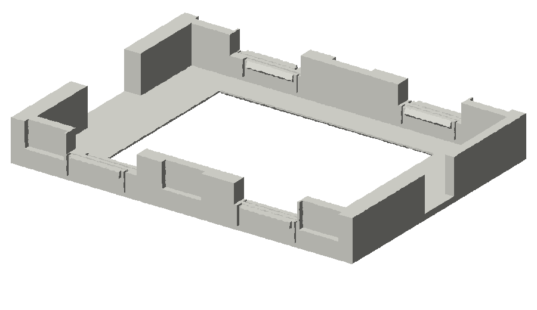

# The frame

The Kindle sits in an IKEA RÖDALM 13×18 cm frame, held by a 3D-printed insert. The front
of the insert is the mat you see; the back is a pocket the Kindle snaps into, with room
beside it for a flat USB cable.

## Print the insert

| Frame | Kindle | File |
|---|---|---|
| RÖDALM 13×18 cm | Paperwhite 4 | [insert-rodalm13x18.3mf](../insert/insert-rodalm13x18.3mf) ([.stl](../insert/insert-rodalm13x18.stl)) |
| RÖDALM 13×18 cm | Paperwhite 2 | [insert-rodalm13x18-pw2.3mf](../insert/insert-rodalm13x18-pw2.3mf) ([.stl](../insert/insert-rodalm13x18-pw2.stl)) |
| RÖDALM 21×30 cm | Paperwhite 4 | [insert-rodalm21x30.3mf](../insert/insert-rodalm21x30.3mf) ([.stl](../insert/insert-rodalm21x30.stl)) |

- Print face down in PETG, with no brim or skirt. PLA works, but its spring tabs relax
  over time.
- Each insert fits a 180 mm print bed and uses about 54 cm³ of filament.
- The 13×18 insert needs a flat ribbon USB cable, because a normal plug doesn't fit beside
  the Kindle. The 21×30 takes any right-angle plug.
- Only the Paperwhite 4 13×18 insert has been printed and used. The Paperwhite 2 version
  comes from a test fit in it: 0.5 mm more along the port edge and a 40 mm cable slot. The
  21×30 insert hasn't been built yet; measure its mat opening before printing.

## Print the back board

[backboard-rodalm13x18.3mf](../insert/backboard-rodalm13x18.3mf) ([.stl](../insert/backboard-rodalm13x18.stl))
replaces the frame's hardboard back. It has an opening over the charging port and power
button, big enough for a U-turn adapter and a plug pushed into it. It holds like the stock
board: its lip slides into the groove on the port side, and a turn tab locks the other side.

- Print the board outer face down and the tab flat, in PETG. Both are on one plate.
- The tab needs an M3×8 countersunk screw, put in from the inside, and an M3 nyloc nut.
  Tighten it until the tab turns but stays where you leave it. The stock steel tab fits
  the same screw if the printed one is too thick for the groove.
- The board is 177 × 126 × 2.7 mm with a 1.2 mm lip: the stock board, 1 mm shorter so it
  fits a 180 mm bed. The lip's width and the tab's thickness come from photos. Check them
  against the stock board before printing; they are at the top of
  [insert/backboard.py](../insert/backboard.py).

For a different frame, add its size to `FRAMES` in [insert/insert.py](../insert/insert.py)
and run it. The command is at the top of that file.

## Measure what the mat hides

The mat covers the edges of the screen. `safe` in `config.json` tells the display which part
stays visible, as `[left, top, right, bottom]` in pixels. The test pattern shows you the
numbers.

1. Press the Kindle's power button once to wake its Wi-Fi.
2. Run `tools/grid.sh` to put the pattern on the screen.
3. With the Kindle in its frame, read the first label or line you can see at each edge.
   Heavy lines are every 100 pixels, thin lines every 20. For example, two thin lines and
   then `x100` on the left edge means left is 60.
4. Put the four numbers in `safe` on the Kindle.
5. Run `tools/grid.sh check`. It draws a box at `safe`, and all four sides of it should be
   visible, right at the edge of the mat.
6. Run `tools/grid.sh done` to bring the planes back.

The map runs right up to the edges of `safe`. Text stays 1 mm further in, set by `inset`.

