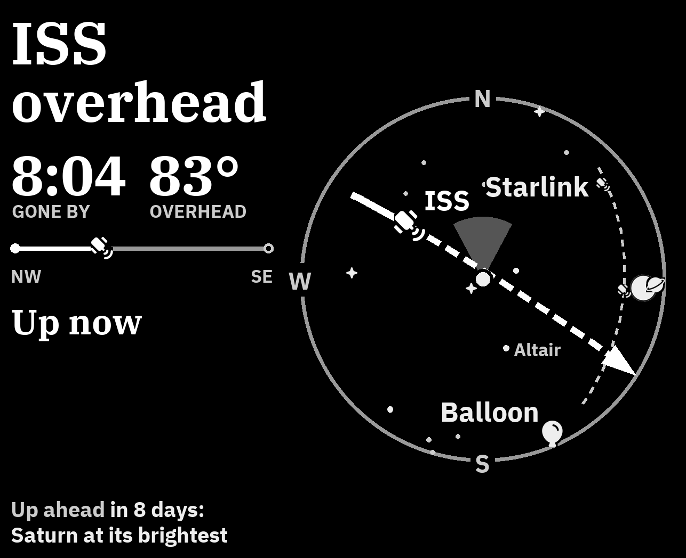

# The sky frame

The sky frame shows what's above your home beyond the planes, as a map of the sky seen
from above. The middle of the circle is straight overhead, the rim is the horizon, and you
are the dot in the middle. Like the planes map and Google Maps, the direction you face when
you look at the frame (`heading` in `config.json`) is at the top, with the cone pointing
that way, and your left is on the left. It's white on black, day and night.



## What it shows

- **The Sun's day.** Its path across the sky today, the hours of daylight, sunset, when
  the stars come out, and where today sits on the year's curve of day length
- **The ISS and China's Tiangong station,** with the path of the next pass you can see
- **The newest Starlink launch,** while its satellites still cross the sky in a line
- **Weather balloons** from the nearest launch site, with a side view of the climb that
  shows where the wind turns, and **hobby balloons** (pico balloons), the small ones radio
  hobbyists send up, which float for weeks and sometimes circle the world
- **The Moon** in its phase, and **Venus, Mars, Jupiter and Saturn**
- **What's coming**: tonight's best thing, and the best of the next two months, like an
  eclipse of the Moon, a meteor shower or Jupiter at its brightest
- **Meteor showers** on their peak nights, at the rate you'd really see from home, with
  the radiant (where the streaks come from) on the dome
- After dark, the brighter stars

## What leads

The headline is the one thing worth looking up for. Every candidate is an event with a
time and a wonder from 1 to 5:

| Wonder | Events |
|---|---|
| 5 | A deep eclipse of the Moon you can see from home |
| 4 | An ISS pass 60° up or more, a Starlink train, a meteor shower you'd see 20 an hour of, a hobby balloon that's been up a week, a shallower eclipse of the Moon |
| 3 | An ISS pass 25° to 60° up, a Tiangong pass 60° up, a weather or hobby balloon in the sky, the full moon, a supermoon or blue moon, a shower of 10 to 20 an hour, a planet at its brightest, the Moon close to Venus or Jupiter, the midnight sun and polar night |
| 2 | Lower passes, the Moon up at night, daylight, a full moon by its old name, a shower of 5 to 10 an hour, the first day of a season |
| 1 | Sunrise, the Moon low in the haze under 10° |

Ties go to what you can see: a station, then a train or a shower, then the Moon and Sun,
then a balloon. Anything below the horizon never leads.

Something happening now scores its wonder. Something still to come scores less the further
off it is, and the bigger it is, the earlier it starts to count: a sunrise matters in the
last half hour, a great ISS pass takes the afternoon before, a big meteor shower the day
before. There's no rotation and no randomness: the same sky always gives the same screen.

## Next and Up ahead

At the foot of the panel, two lines look forward, one short and one long:

- *Next* is the best thing in the coming two days, and when: *ISS 8:49 tonight*, *Moon
  close to Jupiter late tonight*.
- *Up ahead* is the best thing after that, out to two months: *Up ahead in 8 days: Saturn
  at its brightest*. Past three weeks it counts in weeks, so it doesn't change every day.

Up ahead comes from an almanac the Kindle works out once a day, with no network: meteor
showers, full moons by their old names (the Harvest Moon, the Hunter's Moon) and the
special ones (a supermoon, a blue moon), eclipses of the Moon you can see from home,
Mars, Jupiter and Saturn at their brightest, Venus at its highest, the Moon passing close
to Venus or Jupiter, and the turns of the seasons, said as what's good about them
(*Longest day of the year*, *Days start getting longer*). Eclipses are only ever "of the
Moon": the formulas can't tell a total eclipse from a deep partial one reliably, so the
frame never promises which.

Both lines show when they fit. When the panel is full (a pass, a balloon, the Sun's year
curve), they take turns every 10 minutes, on redraws the frame makes anyway, and while
something crosses the sky only Next shows. Neither repeats the headline or each other, and
a coming full moon never leads: as a headline it would name something the dome can't show.

Everything on the screen is in plain words: *Jupiter at its brightest*, not opposition;
*Half moon*, not first quarter; *Geminid meteors*, not just Geminids.

Times never use a 24-hour clock. A big time has its when in words under it (*TONIGHT*,
*LATE TONIGHT*, *TOMORROW MORNING*), which also says am or pm; any other time carries a
small am or pm. A night runs until 6 am, so a pass at 1:30 is *late tonight*.

The distance list beside the dome is its key: everything named on the dome, farthest
first. It only shows in quiet moments, when the headline is the Sun, the Moon or nothing
in particular.

The frame never complains. Shorter days are told as the time the stars come out, and a
meteor shower washed out by the Moon or the city's glow steps back instead of saying so.

## Meteor showers, from here

A shower's published rate is for a perfectly dark sky with its radiant straight overhead.
The frame works out what you'd really see, with the International Meteor Organization's
formula: the rate, times how high the radiant gets, cut by how bright the sky is (set by
`sky_glow` in `config.json`, a city by default, and lowered further while the Moon is up).
It takes the best hour of the night before dawn. From a city that leaves the Geminids,
Perseids and Quadrantids at 10 to 20 an hour, and the smaller showers at 2 to 4, which
never show. On a shower night the Kindle checks the cloud forecast; if the night will be
mostly cloudy, the shower quietly isn't mentioned.

## Turn it on

```bash
ssh kindle sh /mnt/us/planes/run.sh frame sky
```

`run.sh frame planes` switches back. Both write `"frame"` in `config.json` and restart the
display.

## Give it as a gift

The frame can open with a letter. Write it as plain text, paragraphs split by blank lines:
the first is the greeting, the last the sign-off.

```text
Dear Sam,

Happy birthday. You always look up first: at birds, at planes, at the Moon over the lake.

Clear skies, always.
- Jo
```

```bash
tools/gift.sh letter.txt
```

This renders it to `out/gift.png` so you can see it, deploys, and leaves the letter on the
Kindle in place of the sky. Its last line tells whoever unwraps it what to do: *Next: press
the power button to see your sky*. That first press puts the letter away and the sky comes
up; after that the button works as always. The letter is set as large as fits the screen,
up to the size of the sky's own labels, and the script stops if it's too long to read
from across a room.

The letter isn't gone for good. Every year on the day it was first opened, it's back on
the screen, and a press puts it away again. It's also in the Kindle's library as a book,
*A letter for Sam*, to read any time after a second press of the power button hands the
screen back to the Kindle. Run `gift.sh` again to wrap a new letter; its yearly day starts
over from when that one is opened.

## Where the data comes from

- Satellite orbits: [CelesTrak](https://celestrak.org), at most once every 20 hours. The
  Kindle keeps them in `orbits.csv`, so a day without network still shows them.
- Balloons: [SondeHub](https://sondehub.org). In the hours after the weather balloon
  launches at 00:00 and 12:00 UTC, every 15 minutes until one is up, then every 5 to draw
  its climb (every minute on a charger). Otherwise every 3 hours, for off-schedule flights and hobby balloons.
- Cloud cover: [Open-Meteo](https://open-meteo.com), only on meteor shower nights (from
  the morning before, every 6 hours), a few times a year.
- The Sun, Moon, planets, stars and meteor showers are worked out on the Kindle, with no
  network. So Wi-Fi goes on only when orbits, balloons or clouds are due, and in between
  the sky just redraws every 10 minutes, or every minute while something crosses.
  Satellite positions use [sgp4](https://pypi.org/project/sgp4/), and the star catalog
  comes from [d3-celestial](https://github.com/ofrohn/d3-celestial).

## On a charger

Plugged in, the sky frame checks every minute but leaves the screen alone while nothing
much is happening: it changes when the headline, the numbers or what's on the dome change,
and otherwise every 15 minutes as the sky turns. Half an hour before something good, one
clean refresh brings it up. While a pass or a Starlink train crosses, the dome redraws every
15 seconds so you can watch it move, and one more refresh clears the screen after.

## At night

During the `night` hours the Kindle doesn't fetch, and redraws the sky every half hour.

## Preview it

```bash
uv run --python 3.9 --with pillow==9.0.1 --with requests python planes/samples/sheet.py sky out/sky.png
```
